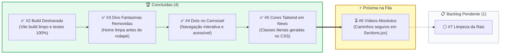

# Painel de Conquistas e Progresso das Issues

Acompanhamento visual da resolução das issues do Portal do Esporte de Betim.

### Progresso Geral

**4 de 6 issues finalizadas (66.7%)**

---

### Quadro de Conquistas Detalhado

| Issue | Status | Categoria | Conquista / Impacto |
|---|:---:|---|---|
| [#2](https://github.com/guilhermetorres02004-spec/Esportes/issues/2) | ✅ **Concluída** | `fix(build)` | **Build destravado**: Rollup/Vite compilando com saída limpa (código 0) e suíte de testes 100% verde. |
| [#3](https://github.com/guilhermetorres02004-spec/Esportes/issues/3) | ✅ **Concluída** | `refactor(home)` | **Layout limpo**: Removidas divs residuais de min-h-screen no fim da Home. |
| [#4](https://github.com/guilhermetorres02004-spec/Esportes/issues/4) | ✅ **Concluída** | `feat(carousel)` | **Navegação visual**: Dots interativos e acessíveis implementados no carrossel. |
| [#5](https://github.com/guilhermetorres02004-spec/Esportes/issues/5) | ✅ **Concluída** | `fix(styles)` | **Estilo Tailwind**: Classes literais geradas e bordas coloridas visíveis em News. |
| [#6](https://github.com/guilhermetorres02004-spec/Esportes/issues/6) | ⏳ **A Iniciar** | `fix(media)` | **Mídia estável**: Garantir reprodução dos vídeos em qualquer rota do portal. |
| [#7](https://github.com/guilhermetorres02004-spec/Esportes/issues/7) | ⚪ **Pendente** | `chore(cleanup)` | **Repositório limpo**: Remover cópias e rascunhos órfãos da raiz de `frontend/`. |
